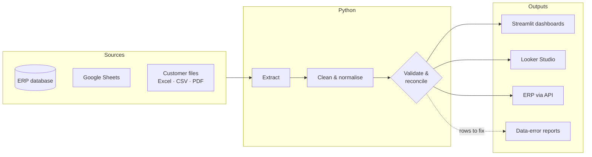

  

  <b>ERP data · Data pipelines · Data quality · Dashboards</b> 
  📍 Lamphun, Thailand · ✉️ <a href="mailto:piyawat.dreamd@gmail.com">piyawat.dreamd@gmail.com</a>

----------------------------------------

I work with real operational data at a food manufacturer. I take messy data from the ERP, Google Sheets and customer files, check it for errors, and turn it into dashboards and tools that sales, warehouse, QC and purchasing teams use every day.

## 🧭 What I do · งานที่ผมทำ

| | Area | What it means in practice |
|---|---|---|
| 🔄 | **Data pipelines** | Pull data from the ERP database, Google Sheets and Excel/CSV/PDF files, then clean and load it automatically |
| ✅ | **Data quality** | Catch bad rows before they reach a report, and reconcile every number against the figures the team already trusts |
| 📊 | **Dashboards** | Build dashboards that answer the team's daily questions: stock on hand, defects in baht, sales trends |
| 🔗 | **ERP integration** | Connect the ERP with the tools people already use (Google Sheets, web forms, company chat) through its API |

## 🛠️ How my data flows · เส้นทางของข้อมูล

## 🗂️ Projects · ผลงาน

> 🔒 Internal company projects: the code and data stay private. Each page covers the problem, the approach, the data flow and the results, with no company or customer data.

**Data Engineering**

| Project | Problem → Result |
|---|---|
| 🧾 [**Purchase-Order Validation → ERP**](projects/02-purchase-order-validation.md) | POs were retyped by hand from many customer formats → **20 formats** (incl. OCR for image PDFs) read, checked against agreed prices, and sent to the ERP after one confirmation |
| 🔁 [**Monthly Retail Sales Pipeline**](projects/04-retail-sales-pipeline.md) | Monthly files were copy-pasted into the dashboard sheet → one command, **safe to re-run**, no duplicates |
| 🗄️ [**ERP Sales Data Quality**](projects/03-erp-sales-data-quality.md) | Bad ERP records reached reports unnoticed → repeatable checks before any KPI is built |

**Data Analysis & Dashboards**

| Project | Problem → Result |
|---|---|
| 📦 [**Finished-Goods Stock Dashboard**](projects/01-stock-dashboard.md) | Stock was checked by filtering a sheet by hand → stock by SKU and lot, **100% reconciled**, with entry errors flagged by row |
| 🏭 [**Production QC Loss Dashboard**](projects/05-qc-loss-dashboard.md) | Defects were tracked only as piece counts → defects shown **in baht**, with Pareto charts of top causes and products |

**ERP Integration & Automation**

| Project | Problem → Result |
|---|---|
| 🛒 [**Purchase Request Tools**](projects/06-purchase-request-tools.md) | ERP screens were hard for occasional users, and approvers missed waiting requests → a simple form plus a Kanban board, with **approvals in the company chat** |

## 🧰 Tools by stage · เครื่องมือตามขั้นตอนงาน

**Extract** 

**Clean & validate** 

**Visualise** 

**Integrate & automate** 

