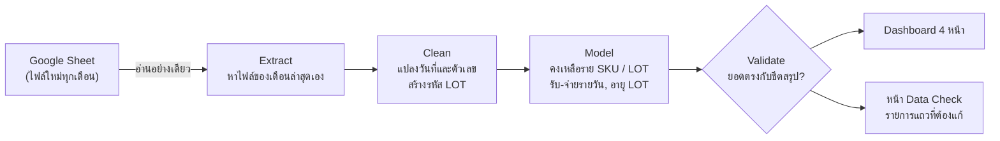
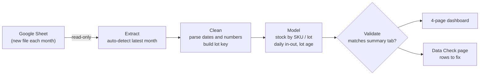

# 📦 Finished-Goods Stock Dashboard

[ภาษาไทย](#ภาษาไทย) · [English](#english)

`Python` `pandas` `Google Sheets API` `OAuth 2.0` `Streamlit` `Plotly` `pytest`

---

## ภาษาไทย

### ปัญหา
ทีมคลังบันทึกการรับเข้าและจ่ายออกสินค้าสำเร็จรูปใน Google Sheet และขึ้นไฟล์ใหม่ทุกเดือน
คนที่ต้องการดูยอดคงเหลือต้องเปิดชีตเองแล้วกรองทีละสินค้า และไม่มีทางรู้ว่า LOT ไหนเก่าสุดหรือแถวไหนกรอกผิด
ข้อมูลผิดจึงไปโผล่ตอนนับสต็อกจริง ซึ่งช้าเกินไป

### เป้าหมาย
- ดูยอดคงเหลือราย SKU และราย LOT ได้ทันทีโดยไม่ต้องแตะชีต
- เห็นยอดรับเข้าและจ่ายออกรายวัน และอายุของแต่ละ LOT เพื่อจ่ายของตามหลัก FIFO
- **จับแถวที่กรอกผิดให้เร็วที่สุด** และบอกได้ว่าต้องแก้แถวไหนอย่างไร

### การไหลของข้อมูล

### วิธีคิดและการตัดสินใจสำคัญ
| เรื่อง | ทางเลือกที่ใช้ | เหตุผล |
|---|---|---|
| ขึ้นเดือนใหม่ | ระบบหาไฟล์ล่าสุดเองจากชื่อไฟล์ และเช็กว่ามีแท็บที่ต้องใช้ | ทีมคลังทำงานแบบเดิมได้ ไม่ต้องมีคนมาแก้ระบบทุกเดือน |
| นิยาม LOT | ใช้ SKU + วันผลิต + เลข LOT ร่วมกัน | สำรวจข้อมูลแล้วพบว่าเลข LOT ซ้ำกันได้ในคนละวันผลิต ถ้าใช้เลข LOT อย่างเดียวยอดจะรวมผิด |
| คอลัมน์ยอดรวมในชีตต้นทาง | ไม่ใช้ แต่คำนวณใหม่จากจำนวนลัง × บรรจุ | พบหลายแถวที่ค่าไม่ตรงกับสูตร จึงไม่น่าเชื่อถือ |
| ความถูกต้อง | กระทบยอดทุก SKU และทุกวันกับแท็บสรุปที่ทีมคลังใช้อยู่ | ถ้าตัวเลขไม่ตรงกับที่ผู้ใช้คุ้นเคย เขาจะไม่เชื่อ Dashboard |
| สิทธิ์เข้าถึงข้อมูล | ขอสิทธิ์อ่านอย่างเดียว | ระบบไม่มีทางไปแก้ข้อมูลต้นทางโดยไม่ตั้งใจ |
| นโยบายองค์กรไม่อนุญาตให้สร้าง Service Account Key | เปลี่ยนไปใช้ OAuth ด้วยบัญชีผู้ใช้ และเขียนโค้ดให้สลับกลับไปใช้ Service Account ได้เองเมื่อได้รับอนุญาต | ไม่ต้องรอ IT ก็เริ่มใช้งานได้ และไม่ต้องแก้โค้ดตอนเปลี่ยนวิธี |

### การตรวจคุณภาพข้อมูล (Data Check)
- 🔴 **ต้องแก้:** LOT ที่คงเหลือติดลบ (จ่ายออกมากกว่ารับเข้า) พร้อมบอกเลขแถวที่จ่ายออก
- 🟡 **ควรตรวจ:** วันผลิตอยู่หลังวันที่ทำรายการ, เลข LOT ไม่ครบหรือผิดรูปแบบ
- ตรวจยอดรวมราย SKU และรายวันกับแท็บสรุปของชีตทุกครั้งที่โหลดข้อมูล

### ผลลัพธ์
- กระทบยอดกับแท็บสรุปของทีมคลังได้ **ตรง 100%** ทั้งราย SKU และรายวัน
- รอบแรกที่รันกับข้อมูลจริงเจอแถวที่ต้องแก้หรือควรตรวจ 14 จุด เพื่อให้ทีมคลังแก้ที่ต้นทาง
- ชุดทดสอบอัตโนมัติ 31 กรณี และนำขึ้น Streamlit Community Cloud แบบจำกัดผู้เข้าถึง

### สิ่งที่ได้เรียนรู้
การกระทบยอดกับตัวเลขที่ผู้ใช้เชื่ออยู่แล้วสำคัญพอๆ กับตัว Dashboard
และหน้า Data Check ที่บอกเลขแถวที่ต้องแก้ ช่วยแก้ปัญหาที่ต้นทางได้ดีกว่าการบอกแค่ว่าตัวเลขผิด

---

## English

### Problem
The warehouse team logs finished-goods receipts and issues in a Google Sheet and starts a new file every month.
To see what was on hand, people had to open the sheet and filter it product by product. Nobody could easily tell which lot was oldest or which rows had been entered wrongly.
Entry errors only came to light at physical stock counts, which was too late.

### Goals
- Show current stock by SKU and by lot without anyone touching the sheet
- Show daily receipts and issues, plus each lot's age so stock can be issued FIFO
- **Catch data-entry errors early**, and say exactly which row to fix and how

### Data flow

### Key decisions
| Topic | Choice | Why |
|---|---|---|
| Monthly rollover | Auto-detect the newest file by name and required tab | The team keeps its workflow and no one has to update the app each month |
| Lot definition | SKU + production date + lot number | Profiling showed the same lot number is reused across production dates |
| Source "Total" column | Ignored; recomputed as cartons × pack size | Many rows didn't match the formula, so the column couldn't be trusted |
| Trust | Reconcile every SKU and every day against the team's own summary tab | Users only trust a dashboard whose numbers match the ones they already know |
| Access | Read-only scope | The app can never accidentally change source data |
| Org policy blocks service-account keys | User OAuth, with automatic fallback to a service account once allowed | Shipped without waiting on IT, and switching later needs no code change |

### Data quality checks
- 🔴 **Must fix:** lots with negative balance, listed with the rows that issued the stock
- 🟡 **Review:** production date later than transaction date; malformed lot numbers
- Reconcile per-SKU and per-day totals against the summary tab on every load

### Results
- **100% reconciliation** with the warehouse team's summary, by SKU and by day
- The first run on live data flagged 14 rows to fix or review, so the warehouse team can fix them at the source
- 31 automated tests; deployed to Streamlit Community Cloud with restricted access

### What I learned
Reconciling to numbers users already trust matters as much as the dashboard itself.
Pointing to the exact row to fix gets errors fixed at the source far better than just saying a number is wrong.
