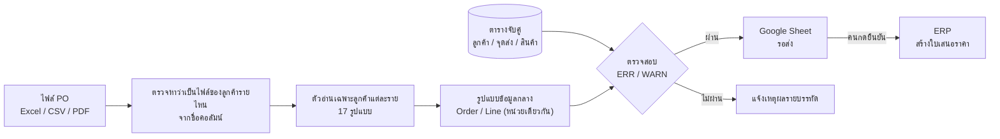
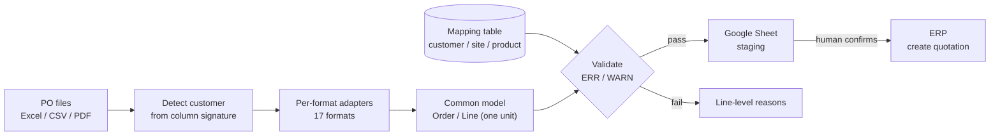

# 🧾 Customer Purchase-Order Validation → ERP

[ภาษาไทย](#ภาษาไทย) · [English](#english)

`Python` `pandas` `openpyxl` `pdfplumber` `Streamlit` `Google Apps Script` `Odoo JSON-RPC`

---

## ภาษาไทย

### ปัญหา
ลูกค้าห้างค้าปลีกและลูกค้าองค์กรแต่ละรายส่งใบสั่งซื้อ (PO) มา**คนละรูปแบบ** มีทั้ง Excel, CSV และ PDF
หน่วยสั่งก็ไม่เหมือนกัน บางรายสั่งเป็นหีบ บางรายเป็นชิ้น และบางไฟล์ระบุหน่วยไม่ตรงกับตัวเลขจริง
ทีมขายต้องอ่านแล้วพิมพ์เป็นใบสั่งขาย (Sales Order) ในระบบ ERP เองทีละใบ
ทำให้ช้า เสี่ยงพิมพ์จำนวนผิด ใส่รหัสสินค้าผิด และเผลอส่ง PO เดิมซ้ำ

### เป้าหมาย
- อัปโหลดไฟล์ PO ได้ทุกรูปแบบ ทีละหลายไฟล์ หลายลูกค้าพร้อมกัน
- แปลงทุกอย่างเป็นหน่วยเดียวกัน และจับคู่กับรหัสลูกค้า จุดส่ง และสินค้าใน ERP
- **ตรวจก่อนส่ง** แล้วค่อยสร้างใบเสนอราคาใน ERP โดยคนเป็นผู้กดยืนยัน

### การไหลของข้อมูล

### วิธีคิดและการตัดสินใจสำคัญ
| เรื่อง | ทางเลือกที่ใช้ | เหตุผล |
|---|---|---|
| รองรับลูกค้าหลายราย | ตัวอ่านแยกต่อรูปแบบไฟล์ แต่ทุกตัวส่งออกเป็นรูปแบบข้อมูลกลางเดียวกัน | เพิ่มลูกค้าใหม่ได้โดยไม่กระทบส่วนตรวจสอบเดิม |
| แยกว่าเป็นไฟล์ของใคร | ดูจาก "ลายเซ็น" ของชื่อคอลัมน์ ไม่ดูจากชื่อไฟล์ | ผู้ใช้ไม่ต้องเลือกลูกค้าหรือตั้งชื่อไฟล์ตามกฎ จึงลดโอกาสพลาด |
| ข้อมูลจับคู่ | เก็บในตาราง Excel ที่ทีมขายแก้เองได้ ไม่ฝังไว้ในโค้ด | เพิ่มสินค้าหรือสาขาใหม่ได้โดยไม่ต้องรอโปรแกรมเมอร์ |
| หลักการตรวจ | **ห้ามเดา** ถ้าไม่แน่ใจให้หยุดและบอกเหตุผล | ส่งข้อมูลผิดเข้า ERP แล้วแก้ทีหลังแพงกว่าการหยุดถามมาก |
| ส่งเข้า ERP | สร้างเป็นใบเสนอราคา ไม่ยืนยันเป็นคำสั่งขายเอง และต้องพิมพ์ "ยืนยัน" ก่อนส่ง | ให้คนเป็นด่านสุดท้ายในทุกขั้นที่แก้ข้อมูลใน ERP |
| ไฟล์เสีย 1 ไฟล์ | ข้ามไฟล์นั้นพร้อมแจ้งเหตุผล โดยไฟล์อื่นในชุดยังทำงานต่อ | อัปโหลดทีละหลายไฟล์ ไม่ควรล้มทั้งชุด |

### สิ่งที่ระบบตรวจ
- **ERR (ห้ามส่ง):** ไม่พบลูกค้า จุดส่ง หรือบาร์โค้ดในตารางจับคู่ · จำนวนบรรจุไม่ตรง · หน่วยที่ไม่รู้จัก · จำนวนไม่ใช่จำนวนเต็มบวก · **ยอดเงินรายบรรทัดและยอดรวมไม่ตรงกับในไฟล์** (ยอมให้ต่างได้ไม่เกิน 0.05 บาท) · เลข PO ซ้ำ หรือเคยส่งเข้า ERP แล้ว
- **WARN (ส่งได้แต่ควรดู):** จุดส่งไม่มีใน ERP ให้ใช้ที่อยู่ลูกค้าแทน · เลข PO ไม่สอดคล้องกับรหัสคลังของลูกค้า
- กับดักที่ต้องรู้จักไฟล์จริงถึงจะเจอ เช่น คอลัมน์ที่ป้ายเขียนว่า "ชิ้น" แต่ตัวเลขจริงเป็น "หีบ" และไฟล์ที่แตกแถวตามสาขาจนยอดนับซ้ำ

### ผลลัพธ์
- รองรับ **17 รูปแบบไฟล์** จากลูกค้ามากกว่า 10 ราย ทั้ง Excel, CSV และ PDF
- งานพิมพ์ PO ซ้ำๆ เปลี่ยนเป็นอัปโหลด → ตรวจ → กดยืนยัน
- กัน PO ซ้ำได้ทั้งในชุดที่อัปโหลดพร้อมกัน และกับ PO ที่เคยส่งเข้า ERP ไปแล้ว

### สิ่งที่ได้เรียนรู้
งานยากไม่ได้อยู่ที่การอ่านไฟล์ แต่อยู่ที่การเข้าใจว่าแต่ละรายใช้หน่วยและตัวเลขอย่างไร
ผมจึงตรวจแต่ละรูปแบบกับไฟล์จริงก่อนเขียนกฎ และให้ระบบตรวจยอดรวมซ้ำกับตัวเลขในไฟล์ทุกครั้ง

---

## English

### Problem
Each retail and corporate customer sends purchase orders in **its own format**: Excel, CSV or PDF.
Units differ too. Some order in cases, some in pieces, and some files label a column one way while the numbers mean another.
The sales team retyped every PO into the ERP as a sales order, which was slow and risked wrong quantities, wrong product codes and duplicate orders.

### Goals
- Upload any PO format, many files and many customers at once
- Normalise everything to one unit and map it to the ERP's customer, delivery-address and product records
- **Validate before sending**, then create quotations in the ERP only after a person confirms

### Data flow

### Key decisions
| Topic | Choice | Why |
|---|---|---|
| Many customers | One adapter per format, all emitting a single common data model | New customers can be added without touching validation |
| Detecting the customer | By a "signature" of column names, not the file name | Users don't pick a customer or follow naming rules, so there's less to get wrong |
| Mapping data | Kept in an Excel table the sales team maintains, not hard-coded | New products or branches don't need a developer |
| Validation principle | **Never guess.** If unsure, stop and explain | Bad data in the ERP costs far more to fix than a pause |
| Writing to the ERP | Create quotations only, never confirmed orders, and require typing "confirm" first | A person stays the last gate on every ERP write |
| One bad file | Skip it with a reason; the rest of the batch continues | A batch upload shouldn't fail as a whole |

### What is validated
- **ERR (blocked):** unknown customer, delivery site or barcode · pack-size mismatch · unknown unit · non-integer quantities · **line and total amounts that don't match the file** (0.05 THB tolerance) · duplicate PO, or a PO already sent to the ERP
- **WARN (allowed, review):** delivery site missing in the ERP (falls back to the customer address) · PO number inconsistent with the customer's warehouse code
- Traps you only find in real files: columns labelled "pieces" that actually hold cases, and files split by branch that would double-count lines

### Results
- **17 file formats** from more than 10 customers, across Excel, CSV and PDF
- Manual retyping replaced by upload → validate → confirm
- Duplicate POs blocked both within a batch and against orders already sent

### What I learned
The hard part isn't parsing files. It's understanding how each customer uses units and numbers.
So I checked every format against real files before writing rules, and the system cross-checks totals against the source file every time.
