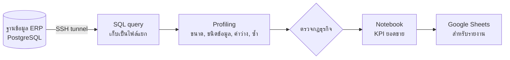
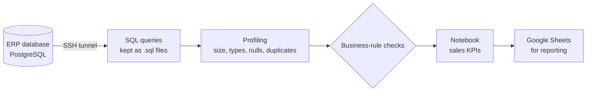

# 🗄️ ERP Sales Data Extraction & Quality Checks

[ภาษาไทย](#ภาษาไทย) · [English](#english)

`Python` `SQL` `PostgreSQL` `SSH tunnel` `pandas` `psycopg2` `Jupyter` `Google Sheets API`

---

## ภาษาไทย

### ปัญหา
ข้อมูลยอดขายและสต็อกอยู่ในฐานข้อมูลของระบบ ERP ซึ่งเข้าถึงได้จากในเซิร์ฟเวอร์เท่านั้น
การดึงรายงานจากหน้าจอ ERP ทำได้จำกัด และถ้ามีข้อมูลผิด เช่น ไม่มีรหัสสินค้า ยอดติดลบ หรือแถวซ้ำ ก็จะติดไปถึงรายงานผู้บริหารโดยไม่มีใครรู้

### เป้าหมาย
- ดึงข้อมูลจากฐานข้อมูลโดยตรงอย่างปลอดภัย
- ตรวจคุณภาพข้อมูลก่อนนำไปใช้ทำรายงาน
- ทำตัวชี้วัด (KPI) ยอดขายที่ผู้บริหารต้องการ

### การไหลของข้อมูล

### วิธีคิดและการตัดสินใจสำคัญ
| เรื่อง | ทางเลือกที่ใช้ | เหตุผล |
|---|---|---|
| การเข้าถึงฐานข้อมูล | ผ่าน SSH tunnel และเก็บรหัสผ่านในไฟล์ตั้งค่าที่ไม่ขึ้น Git | ไม่ต้องเปิดพอร์ตฐานข้อมูลสู่ภายนอก |
| ที่เก็บ SQL | แยกเป็นไฟล์ `.sql` ไม่เขียนปนในโค้ด Python | อ่านง่าย ทดลองใน SQL client ได้ และเก็บประวัติการแก้ได้ชัดเจน |
| นิยาม "ลูกค้าใหม่" | ดูจากออเดอร์แรกในประวัติ**ทั้งหมด** ไม่ใช่เฉพาะช่วงวันที่ที่กรอง | ถ้ากรองวันที่ก่อน ลูกค้าเก่าที่กลับมาซื้อจะถูกนับเป็นลูกค้าใหม่ |
| ลำดับงาน | ตรวจคุณภาพข้อมูลก่อน แล้วค่อยคำนวณ KPI | ตัวชี้วัดจะน่าเชื่อถือได้ต่อเมื่อข้อมูลต้นทางสะอาด |

### การตรวจคุณภาพข้อมูล
- Profiling: จำนวนแถว ชนิดข้อมูล ค่าว่าง แถวซ้ำ และสถิติพื้นฐานของแต่ละคอลัมน์
- กฎธุรกิจ: ไม่มีรหัสสินค้า · ยอดขายติดลบ · จำนวนน้อยกว่าหรือเท่ากับ 0

### ผลลัพธ์
- มีขั้นตรวจคุณภาพข้อมูลที่รันซ้ำได้ ก่อนส่งข้อมูลไปทำรายงานหรือ BI
- ได้ KPI ยอดขายสะสมรายวัน และสัดส่วนลูกค้าใหม่เทียบกับลูกค้าเดิม

### สิ่งที่ได้เรียนรู้
ตัวชี้วัดที่ฟังดูง่ายอย่าง "ลูกค้าใหม่" ผิดได้เพียงเพราะใส่ตัวกรองวันที่ผิดที่
ผมจึงเขียนนิยามของแต่ละตัวชี้วัดไว้ใน query ให้ชัด และใส่หมายเหตุว่าห้ามแก้ส่วนไหน

---

## English

### Problem
Sales and stock data live in the ERP's database, which is reachable only from inside the server.
The ERP's built-in reports are limited, and bad records such as missing SKUs, negative amounts or duplicates flow straight into management reports unnoticed.

### Goals
- Pull data directly from the database, securely
- Check data quality before anything is reported
- Build the sales KPIs management asked for

### Data flow

### Key decisions
| Topic | Choice | Why |
|---|---|---|
| Database access | Through an SSH tunnel; credentials kept in an untracked config file | The database port is never exposed |
| Where SQL lives | Separate `.sql` files, not strings inside Python | Easier to read, test in a SQL client and review over time |
| "New customer" definition | First order across the **full** history, not just the filtered date range | Filtering dates first would count returning customers as new |
| Order of work | Validate data quality first, then compute KPIs | KPIs are only as trustworthy as their inputs |

### Data quality checks
- Profiling: row counts, data types, nulls, duplicates and basic stats per column
- Business rules: missing SKU · negative sales amount · quantity ≤ 0

### Results
- A repeatable data-quality step before anything reaches reports or BI
- KPIs for daily cumulative sales and new vs returning customers

### What I learned
A metric that sounds simple, like "new customer", can be wrong just because a date filter sits in the wrong place.
So I state each metric's definition in the query itself and note which parts must not change.
