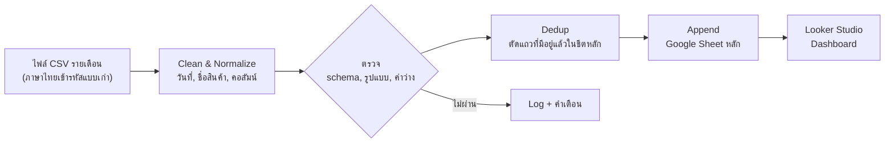
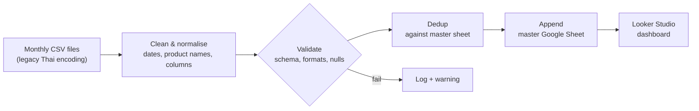

# 🔁 Monthly Retail Sales Pipeline → Looker Studio

[ภาษาไทย](#ภาษาไทย) · [English](#english)

`Python` `pandas` `gspread` `Google Sheets API` `Looker Studio`

---

## ภาษาไทย

### ปัญหา
ทุกเดือนจะได้ไฟล์ยอดขายและสต็อกรายสาขาจากห้างค้าปลีกรายหนึ่ง เป็นไฟล์ CSV ที่เข้ารหัสภาษาไทยแบบเก่า และรูปแบบไม่สม่ำเสมอ
ต้องคัดลอกวางเข้าชีตหลักที่ต่อกับ Dashboard เอง ซึ่งใช้เวลานาน และเสี่ยงวางซ้ำหรือวางผิดคอลัมน์

### เป้าหมาย
- วางไฟล์ไว้ในโฟลเดอร์ แล้วรันคำสั่งเดียวให้ข้อมูลขึ้น Dashboard
- **ไม่มีแถวซ้ำ** แม้จะรันซ้ำหรือใส่ไฟล์เดิมเข้าไปอีก
- ถ้ารูปแบบไฟล์เปลี่ยน ให้แจ้งเตือนให้เห็น ไม่ใช่ปล่อยข้อมูลเพี้ยนเข้าไป

### การไหลของข้อมูล

### วิธีคิดและการตัดสินใจสำคัญ
| เรื่อง | ทางเลือกที่ใช้ | เหตุผล |
|---|---|---|
| การรันซ้ำ | ตัดแถวที่มีอยู่แล้วในชีตหลักก่อนเพิ่ม | รันกี่ครั้งผลก็เหมือนเดิม ไม่ต้องกลัวกดซ้ำ |
| การเพิ่มข้อมูล | ต่อท้ายเฉพาะแถวใหม่ ไม่เขียนทับทั้งชีต | ข้อมูลเก่าที่ Dashboard ใช้อยู่ไม่เสี่ยงหาย |
| ภาษาไทย | กำหนดการเข้ารหัสไฟล์ให้ชัด และตั้งทั้งระบบให้ใช้ UTF-8 | ตัวอักษรไทยไม่เพี้ยน ทั้งในข้อมูล ชื่อไฟล์ และ log |
| การทดสอบ | แยกทดสอบทีละเรื่อง เช่น การ clean, dedup, ตรวจวันที่, ไฟล์ว่าง, การเข้ารหัส | เวลาพังจะรู้ทันทีว่าพังที่ขั้นไหน |

### ผลลัพธ์
- การอัปเดต Dashboard รายเดือนเหลือแค่ "วางไฟล์ แล้วรันคำสั่งเดียว"
- มีชุดทดสอบครอบคลุมการ clean, dedup, การตรวจคอลัมน์และวันที่, ไฟล์ว่าง และการเข้ารหัสภาษาไทย
- ทุกรอบที่รันมี log เก็บไว้ตรวจย้อนหลัง

### สิ่งที่ได้เรียนรู้
Pipeline ที่ดีต้อง "รันซ้ำแล้วปลอดภัย" ตั้งแต่แรก
เพราะคนใช้จริงจะกดซ้ำเสมอ ไม่ว่าจะไม่แน่ใจว่ารันไปแล้วหรือยัง หรือเพราะไฟล์มาช้า

---

## English

### Problem
Every month a retail partner sends store-level sales and stock as CSV files, in a legacy Thai encoding and with an inconsistent layout.
Someone had to copy-paste them into the master sheet behind the dashboard, which was slow and prone to duplicate or misaligned rows.

### Goals
- Drop the files in a folder, run one command, and the dashboard updates
- **No duplicate rows**, even if the job runs twice or the same file is added again
- If the file layout changes, raise a visible warning instead of loading bad data

### Data flow

### Key decisions
| Topic | Choice | Why |
|---|---|---|
| Re-runs | Remove rows already in the master before appending | Idempotent: running twice gives the same result |
| Loading | Append only new rows; never overwrite the sheet | Historical data the dashboard depends on is never at risk |
| Thai text | Explicit source encoding and UTF-8 everywhere | No garbled Thai in data, file names or logs |
| Testing | Separate tests per concern: cleaning, dedup, date checks, empty files, encoding | When something breaks, the failing stage is obvious |

### Results
- The monthly dashboard update became "drop files, run one command"
- Tests cover cleaning, dedup, column and date validation, empty files and Thai encoding
- Every run leaves a log for later review

### What I learned
A pipeline has to be safe to re-run from day one.
Real users will run it twice when they aren't sure it ran, or when a file arrives late.
