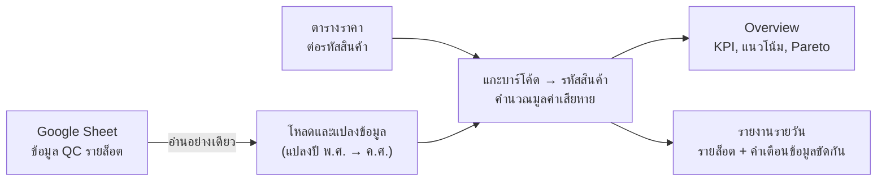
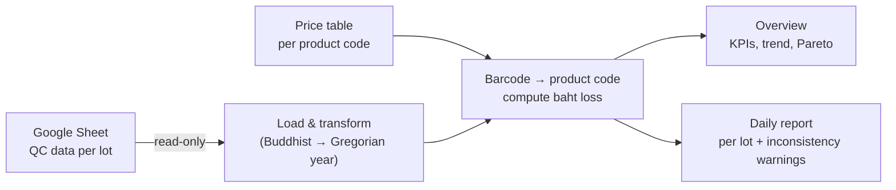

# 🏭 Production QC Loss Dashboard

[ภาษาไทย](#ภาษาไทย) · [English](#english)

`Python` `pandas` `Streamlit` `Plotly` `Google Sheets API` `Jupyter`

---

## ภาษาไทย

### ปัญหา
ฝ่ายผลิตและห้องแพคบันทึกของเสีย (NG) รายล็อตใน Google Sheet แต่ตัวเลขที่ได้เป็น "จำนวนชิ้น"
ผู้บริหารจึงไม่เห็นว่าของเสียคิดเป็นเงินเท่าไหร่ สินค้าตัวไหนเสียมากที่สุด และเสียเพราะอะไร

### เป้าหมาย
- เห็นอัตราของเสีย (Loss %) รายวันและแนวโน้ม
- เห็นสาเหตุหลักและสินค้าที่เสียมากที่สุด (Pareto)
- **แปลงของเสียเป็นมูลค่าเงินบาท** เพื่อจัดลำดับว่าควรแก้ปัญหาไหนก่อน

### การไหลของข้อมูล

### วิธีคิดและการตัดสินใจสำคัญ
| เรื่อง | ทางเลือกที่ใช้ | เหตุผล |
|---|---|---|
| มูลค่าเสียหาย | แกะรหัสสินค้าและขนาดจากบาร์โค้ด แล้วจับคู่กับตารางราคา | ในชีตไม่มีราคา แต่บาร์โค้ดมีข้อมูลพอให้หาราคาได้ |
| สินค้าที่ยังไม่มีราคา | นับเป็น 0 บาท และบอกชัดว่าตัวเลขที่แสดงเป็น **ค่าขั้นต่ำ** พร้อมรายชื่อสินค้าที่ยังขาดราคา | ไม่แต่งตัวเลขขึ้นเอง และให้ผู้ใช้รู้ว่าข้อมูลยังขาดตรงไหน |
| ข้อมูลต่างแท็บใช้ปีต่างกัน | ระบบรู้ว่าแท็บไหนใช้ พ.ศ. แล้วแปลงเป็น ค.ศ. ให้ | สำรวจข้อมูลแล้วพบว่าถ้าไม่แปลง มูลค่าทั้งหมดจะกลายเป็น 0 |
| ตัวเลขในชีตขัดกันเอง | หน้ารายงานขึ้นคำเตือนให้เอง เช่น ของเสียมากกว่ายอดที่นำไปแพ็ค | ให้ข้อมูลผิดถูกแก้ที่ต้นทาง ไม่ถูกเฉลี่ยกลบไป |
| โครงสร้างโค้ด | แยกส่วนคำนวณออกจากส่วนแสดงผล | รันคำนวณจากบรรทัดคำสั่งได้ และทดสอบได้โดยไม่ต้องเปิดเว็บ |

### ผลลัพธ์
- Dashboard 2 หน้า คือ Overview (KPI 5 ตัว แนวโน้ม สาเหตุ Pareto และมูลค่าเสียหายรายสินค้า) และรายงานรายวัน (เทียบกับวันก่อนหน้า และยอดสะสมตั้งแต่ต้นเดือน)
- ตัวกรองช่วงเวลาและกลุ่มสินค้า
- ใช้งานจริงบน Streamlit Community Cloud

### สิ่งที่ได้เรียนรู้
Dashboard ที่ดีต้องบอกข้อจำกัดของตัวเองตรงๆ เช่น "ตัวเลขนี้เป็นค่าขั้นต่ำ เพราะของเสีย 17% ยังไม่มีราคา" ผู้ใช้จะได้รู้ว่าตัวเลขเชื่อได้แค่ไหน และรู้ว่าต้องเติมข้อมูลตรงไหน
ระหว่างทางยังได้เรียนรู้กับดักของภาษาไทยในโค้ดด้วย เช่น Python แปลงสระ "ำ" ในชื่อตัวแปร ทำให้หาคอลัมน์ภาษาไทยไม่เจอ

---

## English

### Problem
Production and packing log defects (NG) per lot in a Google Sheet, but only as **piece counts**.
Management couldn't see what defects cost in money, which products were worst, or why they happened.

### Goals
- Daily loss % and trend
- Top causes and worst products (Pareto)
- **Convert defects into Thai baht** so problems can be ranked by cost

### Data flow

### Key decisions
| Topic | Choice | Why |
|---|---|---|
| Baht value | Parse product and size from the barcode, then join to a price table | The sheet has no prices, but barcodes carry enough to find them |
| Missing prices | Count as 0 and label totals clearly as a **minimum**, listing the unpriced items | Never invent numbers; show users exactly what's missing |
| Mixed calendars | Detect which tab uses the Thai Buddhist year and convert it | Profiling showed every value became 0 without the conversion |
| Self-contradicting rows | The daily page warns automatically (e.g. defects > units packed) | Bad data gets fixed at the source instead of averaged away |
| Code structure | Calculation layer separate from the UI | Calculations run from the command line and can be tested without the web app |

### Results
- Two pages: Overview (5 KPIs, trend, causes, Pareto, baht loss by product) and Daily Report (vs previous day, month-to-date)
- Date-range and product-group filters
- In production on Streamlit Community Cloud

### What I learned
A good dashboard states its own limits, e.g. "this is a minimum because 17% of defective units have no price yet", so users know how far to trust a number and what data still needs filling in.
I also hit Thai-specific traps in code, such as Python normalising the Thai vowel "ำ" in identifiers, which silently broke Thai column lookups.
