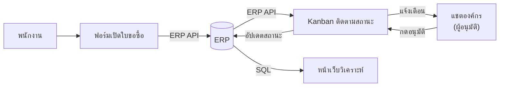
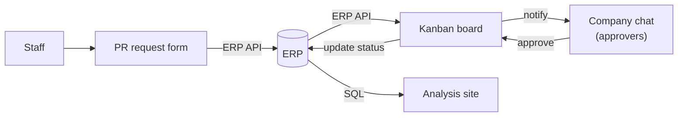

# 🛒 Purchase Request Tools on top of the ERP

[ภาษาไทย](#ภาษาไทย) · [English](#english)

`Google Apps Script` `JavaScript` `HTML` `Odoo JSON-RPC` `Lark API` `Python` `FastAPI` `PostgreSQL`

---

## ภาษาไทย

### ปัญหา
พนักงานหลายแผนกต้องเปิดใบขอซื้อ (Purchase Request, PR) ในระบบ ERP แต่หน้าจอ ERP ซับซ้อนสำหรับคนที่ไม่ได้ใช้ทุกวัน
ผู้อนุมัติไม่รู้ว่ามีใบรออนุมัติอยู่ ส่วนผู้ขอก็ไม่รู้ว่าใบของตัวเองไปถึงขั้นไหนแล้ว

### สิ่งที่สร้าง (3 เครื่องมือที่ทำงานร่วมกัน)
| เครื่องมือ | ทำอะไร | เทคโนโลยี |
|---|---|---|
| **ฟอร์มเปิดใบขอซื้อ** | ฟอร์มเว็บง่ายๆ สำหรับพนักงาน ส่งใบขอซื้อเข้า ERP เป็นฉบับร่าง พร้อมหน้าดูประวัติคำขอของตัวเอง | Google Apps Script, ERP API |
| **Kanban ติดตามสถานะ** | แสดงใบขอซื้อตามขั้นตอน (ร่าง → รออนุมัติ → อนุมัติ/ไม่อนุมัติ → เสร็จ) พร้อมยอดเงินแต่ละขั้น เปลี่ยนสถานะได้ และแจ้งผู้อนุมัติผ่านแชตองค์กร | Google Apps Script, ERP API, Lark API |
| **หน้าเว็บวิเคราะห์ระดับรายการสินค้า** | ดึงข้อมูลรายบรรทัดจากฐานข้อมูลเพื่อดูภาพรวมการขอซื้อ | Python, FastAPI, SQL ผ่าน SSH tunnel |

### การไหลของข้อมูล

### วิธีคิดและการตัดสินใจสำคัญ
| เรื่อง | ทางเลือกที่ใช้ | เหตุผล |
|---|---|---|
| แพลตฟอร์ม | สร้างบน Google Workspace ที่ทุกคนใช้อยู่แล้ว | ไม่ต้องตั้งเซิร์ฟเวอร์ และไม่ต้องสอนระบบใหม่ |
| สิทธิ์ใน ERP | ฟอร์มสร้างใบได้แค่ฉบับร่าง ส่วนการอนุมัติยังอยู่ในขั้นตอนเดิม | ลดงานกรอกโดยไม่ข้ามขั้นตอนควบคุมของฝ่ายจัดซื้อ |
| ค่าลับ | เก็บรหัสเชื่อมต่อใน Script Properties ไม่เขียนไว้ในโค้ด | แชร์โค้ดได้โดยรหัสไม่หลุด |
| ความปลอดภัยของการแจ้งเตือน | ระบบรับคำสั่งอนุมัติจากแชตเฉพาะเมื่อมีรหัสยืนยันถูกต้อง | กันคนนอกยิงคำสั่งปลอมเข้ามาเปลี่ยนสถานะใบขอซื้อ |
| หน้าเว็บวิเคราะห์ | เปลี่ยนจากดึงข้อมูลสดเป็นภาพข้อมูล ณ เวลาหนึ่ง (snapshot) | ใช้งานง่าย และไม่ต้องเปิดการเชื่อมต่อฐานข้อมูลค้างไว้ (ปัจจุบันพักการพัฒนาไว้) |

### ผลลัพธ์
- พนักงานเปิดใบขอซื้อผ่านฟอร์มง่ายๆ ได้เอง โดยไม่ต้องเข้าหน้าจอ ERP
- ผู้อนุมัติได้รับแจ้งเตือนทันทีในแชตที่ใช้อยู่ทุกวัน
- ทุกคนเห็นสถานะใบขอซื้อในหน้าเดียว

### สิ่งที่ได้เรียนรู้
เครื่องมือที่คนใช้จริงคือเครื่องมือที่อยู่ในที่ที่เขาทำงานอยู่แล้ว
และการต่อเข้ากับ ERP ควรเริ่มจากสิทธิ์น้อยที่สุดที่ทำงานได้ เช่น สร้างได้แค่ฉบับร่าง แล้วค่อยขยายเมื่อมั่นใจ

---

## English

### Problem
Staff across departments need to raise purchase requests (PRs) in the ERP, but its screens are complex for people who don't use it every day.
Approvers didn't know when something was waiting for them, and requesters couldn't see where their request stood.

### What I built (three connected tools)
| Tool | What it does | Tech |
|---|---|---|
| **PR request form** | A simple web form that creates draft PRs in the ERP, plus a page where staff see their own request history | Google Apps Script, ERP API |
| **Kanban status board** | PRs by stage (draft → to approve → approved/rejected → done) with totals per stage; change status and notify approvers in the company chat | Google Apps Script, ERP API, Lark API |
| **Line-level analysis site** | Pulls PR lines from the database for an overall view of purchasing | Python, FastAPI, SQL over SSH tunnel |

### Data flow

### Key decisions
| Topic | Choice | Why |
|---|---|---|
| Platform | Built on Google Workspace, which everyone already uses | No servers to run and nothing new to train on |
| ERP permissions | The form only creates drafts; approval stays in the existing process | Less data entry without bypassing purchasing controls |
| Secrets | API credentials in Script Properties, never in code | The code can be shared without leaking credentials |
| Chat callback security | Approval callbacks are accepted only with a valid verification token | Outsiders can't forge requests that change PR status |
| Analysis site | Moved from live queries to a data snapshot | Simpler to run with no open database connection (currently paused) |

### Results
- Staff raise PRs through a simple form, without opening the ERP
- Approvers are notified instantly in the chat they use every day
- Everyone sees PR status on a single page

### What I learned
People use the tools that live where they already work.
ERP integrations should start with the least access that works, such as drafts only, and widen once proven.
