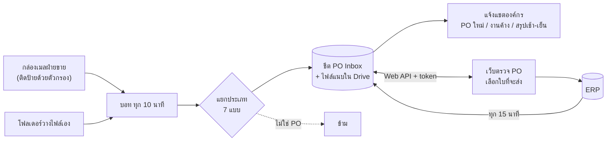
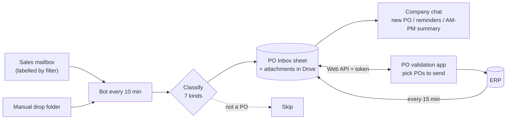

# 📥 Purchase-Order Email Inbox Bot

[ภาษาไทย](#ภาษาไทย) · [English](#english)

`Google Apps Script` `Gmail API` `Google Drive API` `Google Sheets` `Lark API` `clasp` `Streamlit`

---

## ภาษาไทย

### ปัญหา
ใบสั่งซื้อ (PO) จากลูกค้าเข้ามาที่กล่องเมลฝ่ายขายปนกับเมลอื่นอีกมาก เช่น ใบแจ้งหนี้ ใบกำกับภาษี แจ้งโอนเงิน หรือแจ้งขนส่ง
บางรายแนบไฟล์ PO มาเลย บางรายแค่แจ้งเลข PO แล้วต้องเข้าไปโหลดเองในเว็บของลูกค้า บางรายใส่รายการสินค้าไว้ในเนื้อเมล
ทีมขายต้องไล่เปิดเมลเองทุกฉบับ จึงพลาด PO ได้ง่าย และไม่มีที่ไหนบอกว่า PO ไหนทำไปแล้วหรือยังค้างอยู่

### เป้าหมาย
- ดึง PO จากเมลมาเป็นรายการเดียวที่ทั้งทีมเห็นตรงกัน พร้อมสถานะ
- แยกเมลที่ไม่ใช่ PO ออกอัตโนมัติ และไม่ลง PO ซ้ำ
- แจ้งทีมทันทีเมื่อมี PO ใหม่ และเตือนเมื่อมีงานค้าง

### การไหลของข้อมูล

### วิธีคิดและการตัดสินใจสำคัญ
| เรื่อง | ทางเลือกที่ใช้ | เหตุผล |
|---|---|---|
| แยกประเภทเมล | ตารางผู้ส่งที่รู้จัก (อีเมล คำในหัวเรื่อง รูปแบบเลข PO แบบ regex) ที่ทีมแก้เองได้ในชีต | ลูกค้าใหม่หรือรูปแบบเปลี่ยนก็เพิ่มได้โดยไม่ต้องแก้โค้ด |
| กันซ้ำ | รหัสอ้างอิงตามลูกค้า+เลข PO และลายนิ้วมือไฟล์ (MD5) | ลูกค้าบางรายส่งเมลเดิมซ้ำ หรือไฟล์เดียวกันติดมากับเมลตอบกลับ |
| สถานะ | 10 สถานะ ตั้งแต่ "รอโหลดไฟล์" ถึง "Confirm แล้ว" โดยสถานะสุดท้ายอัปเดตจาก ERP เอง | ทีมเห็นว่าใบไหนเสร็จจริงในระบบ ไม่ใช่แค่มีคนบอกว่าทำแล้ว |
| บัญชีที่รันบอท | รันในบัญชีกล่องเมลฝ่ายขาย แต่โอนไฟล์ไปเก็บในบัญชีกลาง | อ่านเมลได้ตรงๆ และไม่ใช้พื้นที่ของกล่องเมลขาย |
| เฝ้าบอท | อีกบัญชีหนึ่งคอยเช็กทุกชั่วโมง ถ้าบอทเงียบเกิน 2 ชั่วโมงในเวลางานจะแจ้งเตือน | บอทที่หยุดเงียบๆ อันตรายกว่าบอทที่ error ให้เห็น |
| เชื่อมกับเว็บตรวจ PO | Web API ที่ต้องมี token ทุกคำขอ | เว็บอ่าน/เขียนชีตได้โดยไม่ต้องแชร์ชีตให้ทุกคน |
| สิ่งที่บอทไม่ทำ | ไม่กดยืนยัน PO ในระบบของลูกค้าแทนคน แต่เตือนในการ์ดว่าต้องทำภายในกี่ชั่วโมง | การยืนยันกับลูกค้าเป็นข้อผูกพัน ควรให้คนตัดสินใจ |

### ผลลัพธ์
- PO จากเมลรวมอยู่ในรายการเดียว ทีมขายเห็นสถานะตรงกันแบบ real-time
- รองรับ PO 7 ลักษณะ ทั้งไฟล์แนบ (รวม .zip) แจ้งเลข PO อย่างเดียว และรายการในเนื้อเมล
- แจ้งเตือนในแชตที่ทีมใช้อยู่ทุกวัน พร้อมสรุปงานเช้าและเย็น
- ใช้งานจริงกับฝ่ายขาย

### สิ่งที่ได้เรียนรู้
ระบบอัตโนมัติที่ทำงานเบื้องหลังต้องมีตัวเฝ้าด้วยเสมอ และกฎการแยกข้อมูลควรอยู่ในที่ที่ผู้ใช้แก้เองได้ ไม่ใช่ในโค้ด

---

## English

### Problem
Customer purchase orders landed in the sales mailbox mixed with invoices, tax receipts, payment advices and shipping notices.
Some customers attach the PO file, some only send a PO number to download from their portal, and some put the item list in the email body.
The team opened every email by hand, POs were easy to miss, and nothing showed which POs were done or still pending.

### Goals
- Turn PO emails into one shared list with a status
- Filter out non-PO email automatically and never register a PO twice
- Notify the team about new POs and remind them about pending ones

### Data flow

### Key decisions
| Topic | Choice | Why |
|---|---|---|
| Classification | A sender table (address, subject keywords, PO-number regex) the team edits in the sheet | New customers or changed formats need no code change |
| Deduplication | Reference keys per customer + PO number, plus file fingerprints (MD5) | Some customers resend the same email, or the same file comes back on replies |
| Status | 10 statuses from "waiting for download" to "confirmed", the last one synced back from the ERP | The team sees what is really done in the system, not just what someone said |
| Account | Runs in the sales mailbox account but stores files in a shared company account | Direct mailbox access without using the mailbox's storage |
| Watchdog | A second account checks hourly and alerts if the bot has been silent for 2 hours in working time | A bot that stops silently is worse than one that fails loudly |
| Web app link | Token-protected Web API | The app reads and writes the sheet without sharing it with every user |
| What the bot won't do | It never confirms POs in a customer's portal; it reminds people of the deadline instead | Confirming to a customer is a commitment a person should make |

### Results
- PO emails collected into one list, with a shared real-time status for the sales team
- Handles 7 kinds of PO email, including attachments (incl. .zip), number-only notices and items in the body
- Notifications in the chat the team already uses, plus morning and evening summaries
- In production with the sales team

### What I learned
Every background automation needs a watchdog, and classification rules belong where users can edit them, not in code.
