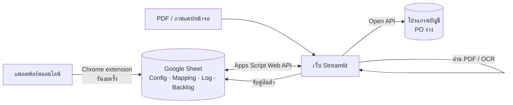
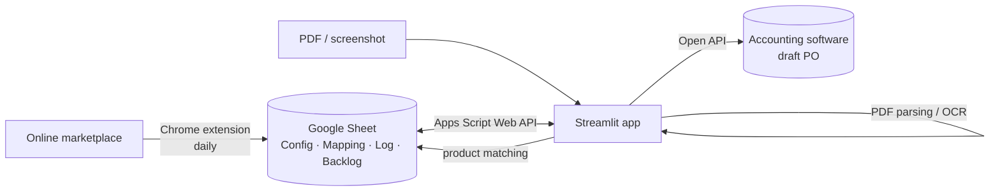

# 🧮 Marketplace Orders → Accounting Purchase Orders

[ภาษาไทย](#ภาษาไทย) · [English](#english)

`Python` `Streamlit` `pdfplumber` `OCR` `PEAK Open API (HMAC)` `Google Apps Script` `Chrome Extension (MV3)`

---

## ภาษาไทย

### ปัญหา
ฝ่ายจัดซื้อซื้อของใช้หลายรายการผ่านแพลตฟอร์มออนไลน์แบบเก็บเงินปลายทาง
ทุกออเดอร์ต้องมีใบสั่งซื้อ (PO) ในโปรแกรมบัญชี แต่ต้องพิมพ์เองทีละใบจากหลักฐานการรับเงิน
ชื่อสินค้าบนแพลตฟอร์มไม่ตรงกับรหัสสินค้าในบัญชี และมีออเดอร์ย้อนหลังจำนวนมากที่ยังไม่มีใบในระบบ

### เป้าหมาย
- อ่านหลักฐานการรับเงิน (PDF) หรือภาพแคปหน้าจอ แล้วสร้าง PO ในโปรแกรมบัญชีได้ในไม่กี่คลิก
- จำการจับคู่สินค้าครั้งแรก แล้วใช้ซ้ำอัตโนมัติ
- เคลียร์ออเดอร์ย้อนหลังที่ยังไม่มีใบ โดยไม่สร้างซ้ำ

### การไหลของข้อมูล

### วิธีคิดและการตัดสินใจสำคัญ
| เรื่อง | ทางเลือกที่ใช้ | เหตุผล |
|---|---|---|
| เก็บข้อมูล | Google Sheet ผ่าน Apps Script Web API แทน service account | องค์กรปิดการสร้าง key ของ service account จึงหาทางที่ไม่ต้องขอข้อยกเว้นด้านความปลอดภัย |
| ดึงประวัติการซื้อ | Chrome extension ที่ใช้การล็อกอินในเบราว์เซอร์ของเครื่องจัดซื้อ | แพลตฟอร์มไม่มี API สำหรับผู้ซื้อ และไม่ต้องเก็บรหัสผ่านไว้ที่ไหนเลย |
| อ่าน PDF | ดึงตารางตามตำแหน่งคอลัมน์ แก้ภาษาไทยเพี้ยน และตรวจยอดรวมกับหัวเอกสาร | ข้อความใน PDF ภาษาไทยมักสลับลำดับ ต้องมีตัวตรวจซ้ำ |
| OCR ภาพแคปหน้าจอ | ใช้ OCR ของ Google ผ่าน Apps Script และแก้กรณีสัญลักษณ์ ฿ ถูกอ่านเป็นตัวเลข | ไม่ต้องติดตั้งซอฟต์แวร์บนเครื่องผู้ใช้ |
| เชื่อม API บัญชี | ลงลายเซ็น HMAC และขอ token ใหม่เองเมื่อหมดอายุ | ผู้ใช้ไม่ต้องรู้เรื่อง token |
| ความปลอดภัยของข้อมูลบัญชี | ปกติสร้างเป็นร่าง จะอนุมัติทันทีได้เฉพาะใบที่รหัสสินค้าครบจากตารางจับคู่ | ไม่ให้รหัสที่เดามาเข้าบัญชีแบบเงียบๆ |
| ออเดอร์ย้อนหลัง | แยกป้ายเป็น ยังไม่สร้าง / อาจซ้ำ / ไม่แน่ใจ / ราคาสูง / น่าจะของส่วนตัว และบันทึกเหตุผลเมื่อเลือกไม่สร้าง | การตัดสินใจทุกใบตรวจย้อนหลังได้ |

### ผลลัพธ์
- สร้าง PO จากหลักฐานการรับเงินได้ในไม่กี่คลิก แทนการพิมพ์ทีละบรรทัด
- ระบบจำการจับคู่สินค้า ครั้งต่อไปไม่ต้องเลือกซ้ำ
- มีหน้าเคลียร์ออเดอร์ย้อนหลัง พร้อมบันทึกว่าใครตัดสินใจอะไร
- ใช้งานจริงกับฝ่ายจัดซื้อ

### สิ่งที่ได้เรียนรู้
ข้อจำกัดด้านความปลอดภัยขององค์กรไม่ใช่ทางตัน แต่เป็นโจทย์ให้เลือกสถาปัตยกรรมที่เรียบง่ายและปลอดภัยกว่า

---

## English

### Problem
The purchasing team buys supplies on an online marketplace with cash on delivery.
Every order needs a purchase order in the accounting software, typed by hand from the payment receipt.
Marketplace product names don't match accounting product codes, and there was a large backlog of past orders with no PO.

### Goals
- Read the receipt PDF or a screenshot and create the PO in the accounting software in a few clicks
- Remember each product match once and reuse it
- Clear the backlog of past orders without creating duplicates

### Data flow

### Key decisions
| Topic | Choice | Why |
|---|---|---|
| Storage | Google Sheet via an Apps Script Web API instead of a service account | The organisation blocks service-account keys, so I chose a design that needs no security exception |
| Purchase history | A Chrome extension using the purchasing PC's logged-in browser session | The marketplace has no buyer API, and no password is stored anywhere |
| PDF parsing | Column-position table extraction, Thai text repair, and total cross-checks | Thai text in PDFs often comes out reordered, so results need a second check |
| Screenshot OCR | Google's OCR through Apps Script, with fixes for the ฿ sign read as digits | Nothing to install on users' machines |
| Accounting API | HMAC request signing and automatic token refresh | Users never deal with tokens |
| Protecting the books | Drafts by default; instant approval only when every product code comes from the mapping table | Guessed codes never enter the books silently |
| Backlog | Tags for not created / possible duplicate / unsure / high value / likely personal, with a logged reason for every skip | Every decision can be audited later |

### Results
- POs created from receipts in a few clicks instead of line-by-line typing
- Product matches remembered, so they're picked only once
- A backlog page that records who decided what, and why
- In production with the purchasing team

### What I learned
An organisation's security limits aren't a dead end. They push you toward a simpler and safer architecture.
